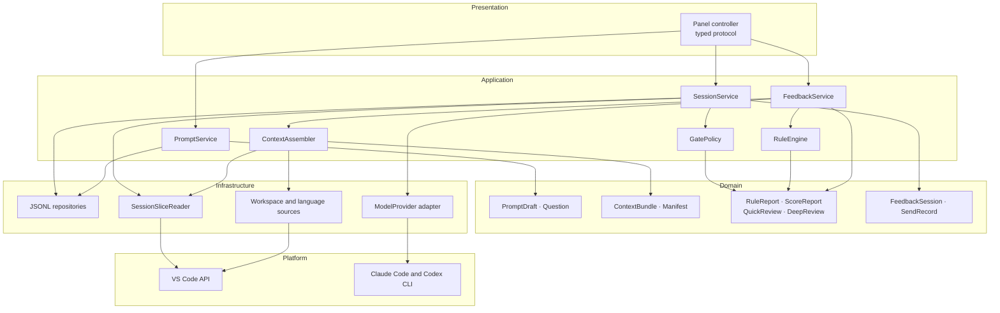

# Preflight LLD

One VS Code extension. Five layers. Ports at every seam.



## Constructs

| Construct | Responsibility |
|---|---|
| Panel | Draft, view state, typed messages |
| PromptService | Draft lifecycle and restore |
| FeedbackService | Quick and deep review orchestration |
| RuleEngine | Instant symbolic findings |
| ContextAssembler | Bounded bundle and manifest |
| GatePolicy | Pure send decision |
| SessionService | Sessions, answers, send records |
| Repositories | JSONL append and snapshot |
| ModelProvider | Provider, model, effort, completion |
| Sources and SliceReader | Workspace, language, git, current session |

## Rules

- Dependencies point down. Domain imports nothing.
- Application uses ports. Infrastructure implements them.
- `core/` has no VS Code imports.
- Invalid model output yields no score, no crash, no gate.
- `gateSending` defaults false.
- Deep feedback receives draft, answers, workspace, and a bounded current-session slice.

## Core flow

```text
FeedbackService.deep(draft, answers)
  ContextAssembler.build -> ContextBundle + ContextManifest
  ModelProvider.complete(bundle) -> DeepReview + ScoreReport
  SessionService.save(review)
  GatePolicy.decide(ruleReport, scoreReport, settings)
```
