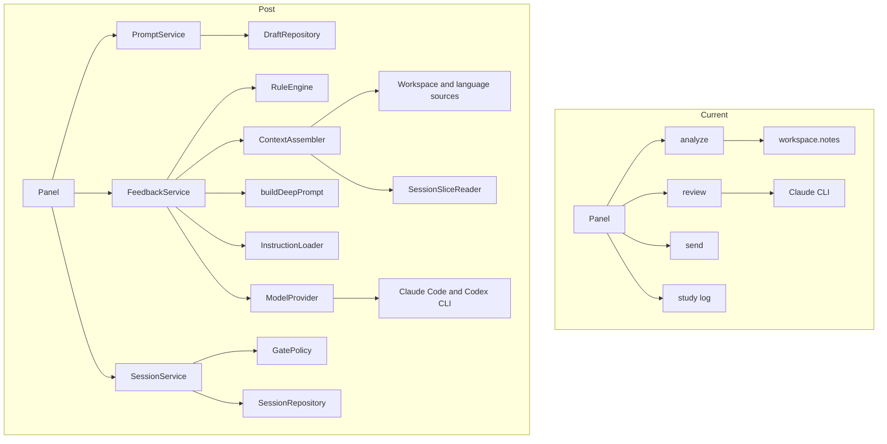
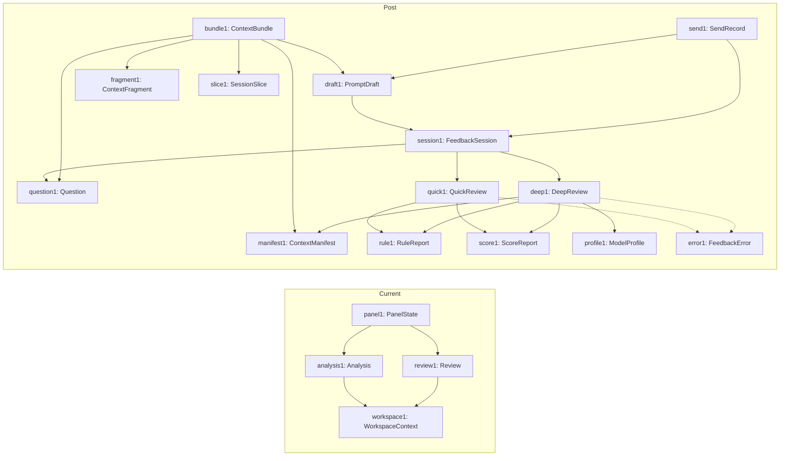
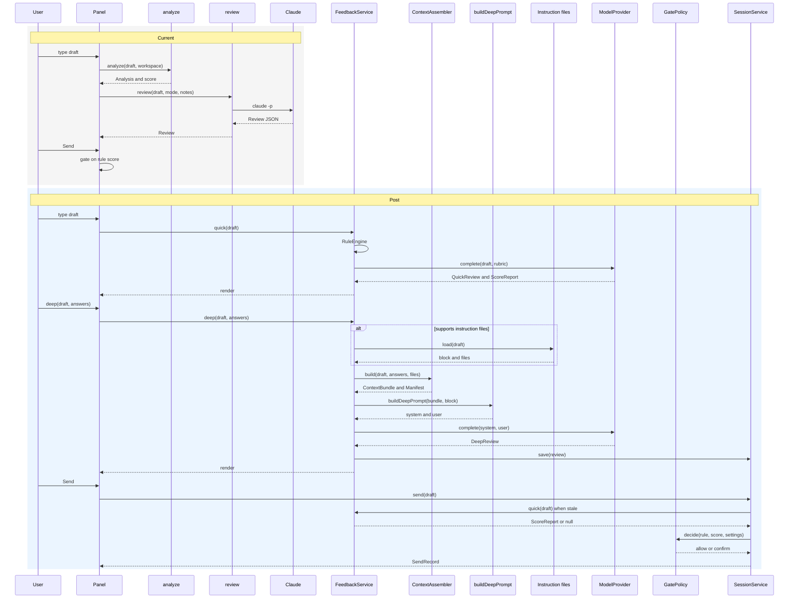
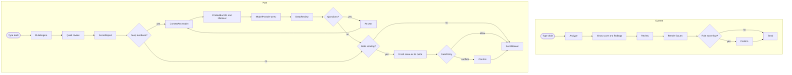

# Preflight LLD

Current prototype versus target design. Prose is short. The diagrams carry the constructs.

## Architecture

Current is a stateless pipeline. Post adds application services, domain objects, and ports. Settings enter as a plain `Config` object at activation. There is no `SettingsService`.

## Objects

Current keeps state in the panel. Post persists the draft, session, bundle, reports, and send record.

## Sequence

Current reviews, then gates on the rule score. Post assembles context, reviews deeply, then applies one gate policy to a fresh score.

## Activity

Current is linear. Post adds a context loop, an answer loop, and a fresh-score step.

